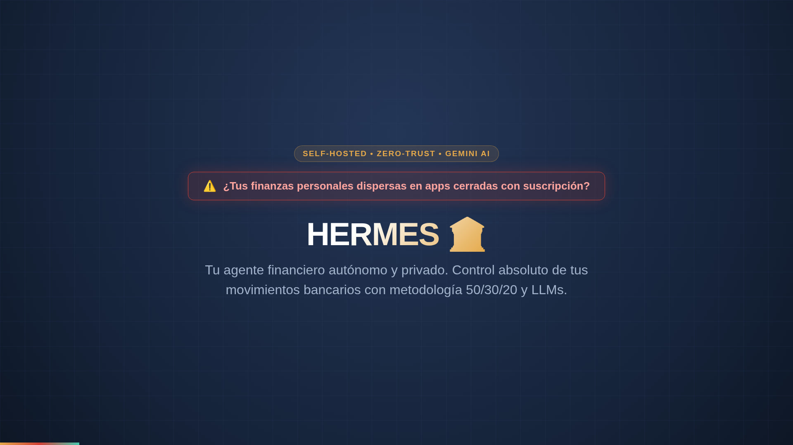

# Cloud Financial Agent (Hermes) 🏛️💰

Sistema privado y *self-hosted* de finanzas personales basado en la regla presupuestal **50/30/20**, diseñado para que el usuario registre y controle **exclusivamente por cuenta propia** sus ingresos y egresos sin vincular cuentas bancarias, correos ni servicios de terceros.

Combina un **backend aislado en Python (FastAPI + SQLite WAL + Google Gemini API + Bot privado de Telegram)** desplegado en servidor propio (**TrueNAS SCALE / Docker Homelab**) con una **aplicación multiplataforma en Flutter** para **Android (Smartphones y Tablets)** y **Linux Desktop**, protegida mediante arquitectura **Zero-Trust** y defensas multicapa contra explotación de IA.

---

### 🎬 Demostración en Video

[](docs/media/hermes_launch.mp4)

> **Nota:** Puedes reproducir el video de presentación en formato MP4 directamente en [`docs/media/hermes_launch.mp4`](docs/media/hermes_launch.mp4).

---

## 📑 Tabla de Contenidos

- [Visión General del Sistema](#-visión-general-del-sistema)
- [Arquitectura y Seguridad](#-arquitectura-y-seguridad)
  - [Regla Presupuestal 50/30/20](#regla-presupuestal-503020)
  - [Privacidad Total: Cero Conexiones Bancarias](#privacidad-total-cero-conexiones-bancarias)
  - [Seguridad en la Transmisión de Datos (Zero-Trust)](#seguridad-en-la-transmisión-de-datos-zero-trust)
  - [Seguridad contra Explotación de IA (Anti-Prompt Injection)](#seguridad-contra-explotación-de-ia-anti-prompt-injection)
- [Stack Tecnológico](#-stack-tecnológico)
- [Estructura del Proyecto](#-estructura-del-proyecto)
- [Guía Paso a Paso de Instalación](#-guía-paso-a-paso-de-instalación)
  - [Paso 1: Obtención de Llaves Necesarias](#paso-1-obtención-de-llaves-necesarias)
  - [Paso 2: Despliegue en Servidor / Homelab](#paso-2-despliegue-en-servidor--homelab)
  - [Paso 3: Compilación e Instalación en Dispositivos](#paso-3-compilación-e-instalación-en-dispositivos)
- [Uso del Sistema](#-uso-del-sistema)
- [Pruebas de Seguridad e Integración](#-pruebas-de-seguridad-e-integración)
- [Licencia](#-licencia)

---

## 🌟 Visión General del Sistema

```text
┌───────────────────────────────┐         Túnel Cifrado         ┌────────────────────────────────────────────────────────┐
│     Dispositivos Clientes     │      WireGuard (Tailscale)    │                   Servidor / Homelab                   │
│                               │                               │                                                        │
│ • App Móvil / Tablet Android  │◄─────────────────────────────►│ • FastAPI REST API (Bearer Auth en Tiempo Constante)   │
│ • App Nativa Linux Desktop    │   Bearer Token Ofuscado +     │ • Registro Manual Exacto + Eliminación de Movimientos  │
│ • Bóveda Biométrica Local     │   Cabeceras HTTP No-Store     │ • Sandbox Gemini (Anti-Prompt Injection + JSON Schema) │
│   (Formulario Manual + IA)    │                               │ • Persistencia Local SQLite3 (Modo WAL, 0 Terceros)    │
└───────────────────────────────┘                               │ • Bot Privado de Telegram + Grafana Analítico (:3000)  │
                                                                └────────────────────────────────────────────────────────┘
```

---

## 🛡️ Arquitectura y Seguridad

### Regla Presupuestal 50/30/20
Cada movimiento registrado manualmente se asigna a uno de los tres bloques presupuestales:
1. **Necesidades (50%):** Vivienda, servicios básicos, alimentación esencial, salud, educación y transporte obligatorio.
2. **Gustos (30%):** Entretenimiento, salidas, restaurantes, suscripciones de ocio y compras personales.
3. **Ahorro (20%):** Fondo de emergencia, inversiones y metas patrimoniales.

El balance mensual calcula dinámicamente `Gastos - Ingresos` por categoría sobre el presupuesto base persistido en SQLite.

### Privacidad Total: Cero Conexiones Bancarias
- **Sin lectura de correos (IMAP) ni intercepción de notificaciones:** Elimina por completo falsos positivos por correos promocionales, alertas duplicadas o exposición de credenciales bancarias/de correo.
- **Cero datos simulados:** La interfaz refleja únicamente los movimientos reales almacenados por el usuario en su propia base de datos SQLite.

### Seguridad en la Transmisión de Datos (Zero-Trust)
- **Red Privada Cifrada (Tailscale):** Todo el tráfico viaja cifrado punto a punto sobre WireGuard sin abrir puertos públicos en el router.
- **Ofuscación Binaria (`envied`):** `Env.apiUrl` y `Env.apiToken` se compilan ofuscados en código máquina; jamás se almacenan secretos ni direcciones IP en el repositorio Git.
- **Autenticación en Tiempo Constante:** Validación de cabeceras `Authorization: Bearer` con `secrets.compare_digest` para prevenir *timing attacks*.
- **Endurecimiento HTTP:** Esquema `/openapi.json` y documentación Swagger deshabilitados en producción, junto con cabeceras `Cache-Control: no-store`, `X-Content-Type-Options: nosniff`, `X-Frame-Options: DENY` y `Referrer-Policy: no-referrer`.
- **Bóveda Biométrica Continua:** Bloqueo automático al minimizar la app (`WidgetsBindingObserver` + `local_auth`).

### Seguridad contra Explotación de IA (Anti-Prompt Injection)
1. **Saneamiento y Escape XML Anti-Breakout:** Los textos del usuario se limpian de caracteres de control, se limitan a `500` caracteres y escapan `<` y `>` (`&lt;`, `&gt;`) antes de encapsularse en `<entrada_usuario_no_confiable>...</entrada_usuario_no_confiable>`.
2. **Firewall Heurístico Pre-LLM:** Bloquea intentos de *Prompt Injection*, *Jailbreak* o extracción de instrucciones del sistema antes de realizar llamadas a la API de Gemini.
3. **Inferencia Determinista sin Herramientas:** Gemini opera con `temperature=0.0`, `max_output_tokens=256`, sin permisos de ejecución de código ni herramientas externas, forzado a un esquema tipado `Pydantic` (`application/json`).
4. **Firewall de Salida Post-LLM y Rate Limiting:** Verifica matemáticamente rangos válidos (`0 < monto <= 1,000,000`), sanea caracteres especiales en las respuestas, valida listas blancas de MIME/tamaño (`5 MB` máx.) en notas de voz y limita las peticiones por minuto (`HTTP 429`).

---

## 🛠️ Stack Tecnológico

| Capa | Tecnologías |
| :--- | :--- |
| **Backend & API** | Python 3.11+, FastAPI, Pydantic v2, Uvicorn |
| **Asistente IA Opcional** | Google Gemini API (`google-genai`) con salida estructurada determinista |
| **Frontend Multiplataforma** | Flutter 3.47+, Dart 3.11+, Material 3 Starfield Dark Theme |
| **Seguridad en Cliente** | `envied` (ofuscación binaria), `local_auth` (biometría local) |
| **Persistencia** | SQLite 3 (`WAL mode`), restricciones `CHECK` e índices optimizados |
| **Infraestructura** | Docker Compose, TrueNAS SCALE / Linux Server, Tailscale VPN, Grafana |

---

## 📂 Estructura del Proyecto

```text
cloud_financial_agent/
├── android/                   # Proyecto nativo Android
├── linux/                     # Proyecto nativo Linux Desktop
├── lib/                       # Aplicación Flutter Multiplataforma
│   ├── core/
│   │   ├── config/            # Configuración Zero-Trust ofuscada (env.dart)
│   │   └── network/           # Cliente HTTP autenticado (api_client.dart)
│   ├── modules/
│   │   ├── auth/              # Pantalla de bloqueo biométrico
│   │   ├── dashboard/         # Resumen 50/30/20 sincronizado con SQLite
│   │   ├── settings/          # Diagnóstico Tailscale, presupuesto y estado de seguridad
│   │   └── transactions/      # Formulario manual directo + dictado IA + borrado
│   └── main.dart              # Tema global y observador de ciclo de vida
├── src/                       # Backend en Python
│   ├── ai_engine.py           # Motor Gemini con firewall Anti-Prompt Injection
│   ├── api.py                 # API REST Zero-Trust con Rate Limiting y cabeceras seguras
│   ├── database.py            # Persistencia SQLite (transacciones y presupuesto)
│   ├── i18n.py                # Internacionalización (es / en)
│   ├── main.py                # Punto de entrada del servicio
│   └── tg_bot.py              # Bot privado de Telegram (registro manual y /reporte)
├── tests/
│   └── test_api.py            # Pruebas unitarias, CRUD manual y seguridad anti-inyección
├── scripts/
│   └── deploy_truenas.sh      # Despliegue automatizado hacia el servidor
├── docker-compose.yml         # Orquestación de backend y Grafana
└── Dockerfile                 # Contenedor ligero de producción con Healthcheck
```

---

## 🚀 Guía Paso a Paso de Instalación

### Paso 1: Obtención de Llaves Necesarias

1. **API Token Zero-Trust (Obligatorio):**
   ```bash
   openssl rand -hex 32
   ```
2. **Google Gemini API Key (Para captura opcional por voz o texto libre):**
   - Genera una llave en [Google AI Studio](https://aistudio.google.com/).
3. **Telegram Bot Token y Chat ID (Opcional):**
   - Crea un bot privado en [@BotFather](https://t.me/BotFather) y consulta tu ID numérico en [@userinfobot](https://t.me/userinfobot).
4. **Tailscale VPN:**
   - Conecta tu servidor y tus dispositivos a la misma red privada Tailscale (`100.x.y.z`).

---

### Paso 2: Despliegue en Servidor / Homelab

1. Copia `.env.example` a `.env` en el directorio del proyecto dentro de tu servidor:
   ```env
   TELEGRAM_TOKEN=tu_telegram_bot_token_aqui
   TELEGRAM_CHAT_ID=tu_chat_id_numerico_aqui
   GEMINI_API_KEY=tu_gemini_api_key_aqui
   GEMINI_MODEL=gemini-2.5-flash
   MONTHLY_INCOME=2400.0
   DEFAULT_LANG=es
   API_URL=http://100.x.y.z:8000
   API_TOKEN=tu_token_generado_con_openssl_rand_hex_32
   ```
2. Levanta los contenedores:
   ```bash
   docker compose up -d --build
   ```
3. Verifica el estado del servicio:
   ```bash
   curl -H "Authorization: Bearer <TU_API_TOKEN>" http://127.0.0.1:8000/api/v1/health
   ```

---

### Paso 3: Compilación e Instalación en Dispositivos

1. Genera el archivo ofuscado de entorno local antes de compilar:
   ```bash
   flutter pub get
   dart run build_runner build --delete-conflicting-outputs
   ```

2. **Compilar APK para Android:**
   ```bash
   flutter build apk --release --split-per-abi
   ```
   El instalador optimizado se genera en `build/app/outputs/flutter-apk/app-arm64-v8a-release.apk`.

3. **Compilar e instalar en Linux Desktop:**
   ```bash
   flutter build linux --release
   mkdir -p "$HOME/.local/share/cloud_financial_agent" "$HOME/.local/bin"
   cp -r build/linux/x64/release/bundle/* "$HOME/.local/share/cloud_financial_agent/"
   ln -sf "$HOME/.local/share/cloud_financial_agent/cloud_financial_agent" "$HOME/.local/bin/cloud-financial-agent"
   ```

---

## 📱 Uso del Sistema

- **Formulario Manual Exacto:** En la pestaña **Movimientos**, elige **Egreso (Gasto)** o **Ingreso**, escribe el monto exacto, el concepto, la categoría (`Necesidades`, `Gustos` o `Ahorro`) y el método de pago, y pulsa **Guardar Movimiento**.
- **Captura Asistida por IA (Opcional):** Dicta con el micrófono o escribe en lenguaje natural (ej. *"Compré despensa por 450 en efectivo"*) para que Gemini estructure el registro automáticamente.
- **Eliminación de Movimientos:** Cualquier registro erróneo puede borrarse con un toque desde el icono de papelera con confirmación.
- **Presupuesto Sincronizado:** En la pestaña **Seguridad / Ajustes**, actualiza tu presupuesto mensual base para sincronizar los topes 50/30/20 en todos tus dispositivos y en `/reporte` de Telegram.

---

## 🧪 Pruebas de Seguridad e Integración

Ejecuta la suite automatizada de pruebas (autenticación Zero-Trust, ocultamiento OpenAPI, CRUD manual, eliminación de rutas bancarias, bloqueo de Prompt Injection, escape XML y Rate Limiting):

```bash
python -m unittest tests/test_api.py -v
flutter analyze
```

---

## 📄 Licencia

Distribuido bajo la licencia **MIT**.
